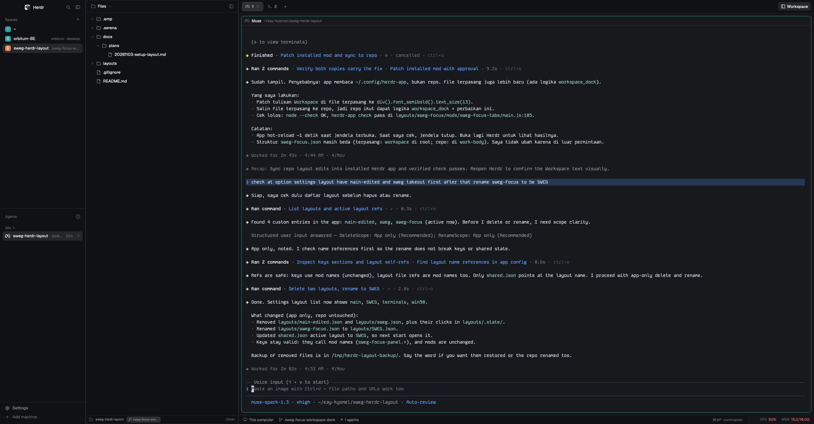

# SWEG layouts for Herdr

SWEG is a set of custom window layouts for [Herdr](https://herdr.dev), the
desktop app for terminals and coding agents. Herdr keeps its whole interface
as plain files in `~/.config/herdr-app`, so a layout is a folder of JSON and
mods that you copy in and switch to. This repo holds those folders, the
tooling to start a new one, and the notes behind the design.



## Layouts

| Layout | What it is |
| ------ | ---------- |
| [sweg](layouts/sweg/) | Main SWEG layout. Files, Git and px0 live in a full-height workspace rail beside the terminal. The rail follows the active space's repo, docks left or right, and has two workspace modes: custom Files and Git panels inside the rail, or the px0 editor window outside Herdr. The layout's own settings page (`cmd-shift-,`) picks the mode, the px0 window style and the dock. |
| [sweg-sidebar](layouts/sweg-sidebar/) | Older sidebar variant. Herdr's `main` layout with Files and Changes moved inside the left sidebar, plus a `</>` pane button and `cmd-shift-e` that open the pane's folder in px0. |

Each layout folder mirrors the layout part of a Herdr home:

```
layouts/<name>/
├── layouts/<name>.json   the layout tree
├── mods/<mod>/           the mods the layout adds
├── keys.json             keys snippet to merge
├── RECIPE.md             the brief another agent can rebuild it from
└── preview.png           screenshot
```

## Install a layout

Herdr reads its home from `~/.config/herdr-app` (`HERDR_APP_HOME` selects
another). Copy the layout file and its mods, merge the keys snippet, check
every mod, then switch:

```sh
cp layouts/sweg/layouts/sweg.json ~/.config/herdr-app/layouts/
cp -R layouts/sweg/mods/* ~/.config/herdr-app/mods/
# merge layouts/sweg/keys.json into ~/.config/herdr-app/keys.json by hand
for mod in layouts/sweg/mods/*/; do herdr-app check "$mod"; done
herdr-app do layout.switch --name sweg
```

Herdr reloads its files while it runs. Switch between layouts with
`ctrl-shift-l`. `keys.json` is a snippet, not a replacement: merge its
sections and keys, and ask before replacing a key a person already uses.

## Build your own layout

From the repo root:

```sh
python3 scripts/new-layout.py my-layout
```

The generator copies [layouts/_template/](layouts/_template/) to
`layouts/my-layout/`, replaces the `{{slug}}` placeholder in file contents
and names, and prints the next steps. For real layouts, start from a shipped
Herdr layout or mod, clone it with `herdr-app do layout.clone` or
`herdr-app do mod.clone`, then edit the copy.

Read [CONTRIBUTING.md](CONTRIBUTING.md) for the layout format, the naming
rules, the verification checklist, the upgrade and drift notes, and the pull
request steps.

## Repo map

```
layouts/
  sweg/                   main SWEG layout
  sweg-sidebar/           older sidebar variant
  _template/              starting point for a new layout
scripts/
  new-layout.py           template -> layouts/<slug>/
docs/
  README.md               docs index
  plans/                  historical plans
  research/               research notes and decisions
CONTRIBUTING.md           how to build, check and share a layout
README.md                 this file
```

The [docs index](docs/README.md) lists the research notes and the historical
plans.

## Naming conventions

- Layout slug: kebab-case, and it matches the folder and the layout file.
  `sweg` lives in `layouts/sweg/` with the layout at
  `layouts/sweg/layouts/sweg.json`. Full rule: `^[a-z][a-z0-9-]{1,31}$`.
- A layout's own mods are named `<layout>-<role>`, for example `sweg-panel`,
  `sweg-tabs` and `sweg-menu`. One mod per folder, one idea per mod.
- Shipped Herdr mods keep their shipped names (`files`, `changes`, `tabs`,
  `pane`, `spaces`, `agents`, `workspace-chrome`). Only edited copies live
  here, and each copy gets the layout prefix.
- File names are kebab-case, for example `px0-workspace.py`. The fixed names
  are `main.js`, `mod.json`, `keys.json`, `RECIPE.md` and `preview.png`.
- Do not rename or move another layout in a PR that adds your own.

## Generated files

`herdr-app check` writes `gpui-kit.d.ts` and `jsconfig.json` next to each mod
for editor support. Both files are generated per mod and ignored by
`.gitignore`. Do not commit them.

Herdr also writes state under `layouts/.state/` and in `~/.config/herdr-app`
(`shared.json`, `settings.json`, `keys.json`, `view.json` and similar). Never
commit live config or state.

## Links

- [Herdr](https://herdr.dev)
- [Layouts gallery](https://herdr.dev/layouts/)
- [Guide](https://herdr.dev/guide/)
- [AGENTS.md - the guide your agent reads](https://github.com/herdrdev/herdr-app/blob/master/defaults/AGENTS.md)
- [herdr-app source](https://github.com/herdrdev/herdr-app)
- [Discord](https://discord.gg/PsgRfzmUDg)
