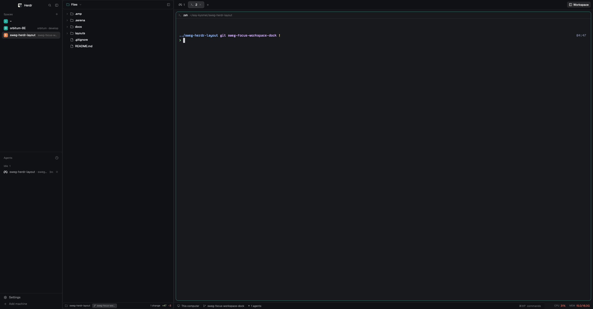

# sweg-focus

`sweg` with the Files/Git/px0 workspace as its own full-height rail beside the
terminal, not a card inside the tab area. The rail follows the active space's
repo, not the focused pane, and docks left (default) or right from
`settings.json` or its header menu.

## What you see

- Left sidebar, 268 px (`chrome`): brand row (46 px), Spaces and Agents
  sharing the height, footer row (69 px). No Files/Changes panel.
- Workspace rail, 344 px default (min 300, max 480), a root column: full
  window height, from the tab bar's top edge to the bottom. Header 40 px
  (active view icon and label, chevron, hide button), content, footer 28 px
  (folder, branch, change counts). It docks right after the sidebar (left) or
  as the last column (right).
- The rail's head/foot draw `bg(chrome)`, `radius` 10 and a 1 px `border`;
  the content mods paint the chrome background and side borders.
- Header click opens a popup: Files, Git, px0, then a `Dock` row with `Left`
  and `Right`. Active rows show a check.
- Work column: shipped-style tab bar without Files/Changes buttons, a `+`
  that hugs the last tab, and a `Workspace` button at the right. Terminal pane
  uses `sweg-pane` (`</>` plus split/zoom/close on hover). Status bar
  unchanged.
- Look comes from the person's `settings.json`; reference build is `graphite`
  with the Gruvbox palette and Kode Mono.

## How it behaves

- Dock side: `settings.json` `"workspace_dock": "left" | "right"` (default
  left). The rail moves without a restart: `sweg-focus-tabs` reads the file
  and reorders the layout with `layout.set`.
- `settings()` drops keys Herdr does not know, so the value is read with
  `readTextFile(appHome() + "/settings.json")`. Herdr rewrites that file from
  its own struct on some saves (zoom, settings screen) and drops unknown keys;
  the menu toggle also stores the pick in `shared("workspace.dock")`, read
  when the key is missing.
- The menu's `Left` / `Right` writes both places and runs
  `sweg-focus-tabs.reload_dock`, so the move is immediate.
- Workspace content follows the space's repo: the first terminal in the space
  with a live folder, else the space's own folder. Switching panes or tabs
  inside the space does not move the rail (Orca's per-worktree explorer, Zed's
  and VS Code's per-workspace panels). Switching spaces follows.
- Header click -> `openOverlay` popup (`sweg-focus-menu`). Choose ->
  `layout.select {stack: "workspace-body", child: "ws-files" | "ws-git" |
  "ws-px0"}` then `layout.show {id: "workspace"}`.
- `Workspace` tab-bar button -> `layout.toggle {id: "workspace"}`. The
  rail header's hide button does the same; its icon flips with the dock side.
- `cmd-shift-b` -> `layout.toggle:workspace` (the app's own command), works
  while the rail is hidden because the key does not go through a mod.
- `cmd-shift-f`, `cmd-shift-g`, `cmd-shift-x` -> `sweg-focus-panel.files`,
  `.git`, `.px0`. The panel head handles these while the rail is shown.
- `cmd-shift-e` -> `sweg-pane.open_editor` (the px0 button/key on a pane).
  That one stays pane-based: it opens the focused pane's folder.
- Files: tree of the space's repo. Click a file for a 34 px preview bar and
  the read-only editor.
- Git: changed-file list, diff, commit bar; the footer shows counts and
  `+add / -del`.
- px0: launcher. Status, folder, `Open px0`, `Split`, and sessions found from
  `terminals()` argv. `Open px0` focuses an existing px0 pane for the folder,
  else splits a pane running `px0 <dir> -port 0`; px0 opens the system
  browser. `Split` always starts a new pane.
- Footer: branch, status and diff every 5 s with `--no-optional-locks`. A
  non-repository folder shows `No repository`.

## Built from

- `layouts/sweg-focus.json`: clone of `main` 0.1.12. Root `row` children are
  `sidebar`, `workspace`, `work`. `workspace` (ids `workspace`,
  `workspace-head`, `workspace-body`, `workspace-foot`; stack children
  `ws-files`, `ws-git`, `ws-px0`) is a root column, full height. `work` holds
  `tabs` (`sweg-focus-tabs`), `work-body` with only `main` (`tab: active`,
  `sweg-pane` header) and `status`. Root `terminal_menu` is `sweg-menu`.
- `mods/sweg-focus-tabs`: clone of `tabs` 0.1.12. Drops `shared` panel
  syncing and the Files/Changes buttons; adds the `Workspace` button, the
  `+` inside the tab-scroll row, and the dock logic:
  `readDock()` (settings.json -> `shared("workspace.dock")` -> `"left"`),
  `applyDock()` (clone `layout()`, move the `workspace` node in
  `root.children`, `run("layout.set", { layout })`), run from `init`, a 2 s
  `cx.timer`, and the `reload_dock` command.
- `mods/sweg-focus-panel`: two copies in the layout (`props.part` head/foot).
  Head: title, chevron, hide (icon follows the dock side), popup, plus
  `pl(lightsPadding)` when the rail is the first column so the macOS window
  buttons keep their room. Foot: folder, branch chip, changes and `+/-`, the
  git timer. `location()` reads the space repo via `place()`, not the
  focused pane.
- `mods/sweg-focus-menu`: popup with the three views and the `Dock` row.
  `saveDock()` calls `setShared("workspace.dock", side)` and best-effort
  rewrites `settings.json` through `readTextFile` + `writeTextFile(expected)`
  with one retry, then runs `sweg-focus-tabs.reload_dock`.
- `mods/sweg-focus-files`, `mods/sweg-focus-changes`: clones of `files` and
  `changes` 0.1.12, headless (no 42 px card header; Files keeps a 34 px
  preview bar). Both use the same space-level `place()` / `location()`.
- `mods/sweg-focus-px0`: launcher view, space-level `location()`, sessions
  matched by argv, 4 s timer.
- `mods/sweg-pane` / `mods/sweg-menu`: copies of the `sweg` mods; the
  `builtin` editor branch checks `workspace-body` first, then `panel-body`.
- `keys.json` snippet: `cmd-shift-b` toggle, `cmd-shift-f/g/x` views,
  `cmd-shift-e` editor. Merge, don't replace.
- Shipped mods used: `workspace-chrome`, `spaces`, `agents`,
  `workspace-status`, `system-stats`; icons from `mods/workspace-chrome/*.svg`,
  `mods/files/folder.svg`, `mods/sweg-pane/code.svg`.
- Programs: `px0 <dir> -port 0` (optional external tool, https://px0.ai).

## Watch out

- `layout.set` replaces the whole tree of a personal layout and persists it to
  `layouts/<name>.json`. Always pass the full `layout()` tree (deep-cloned);
  a partial tree loses nodes. `applyDock()` must stay idempotent: it compares
  the node's current index and skips when already in place, or the 2 s timer
  rewrites the layout forever.
- `settings.json` is not a safe store for custom keys: Herdr serializes its
  own `Person` struct back to the file on some saves and drops unknown keys.
  Read it as a preference, keep `shared("workspace.dock")` as the fallback,
  and never rely on the key surviving a zoom change.
- The app's settings screen (`cmd-,`) is the shipped `frame/settings` mod,
  rewritten on every start. A mod cannot add a row there; the workspace menu
  is the settings UI for this layout.
- Keep the ids `workspace`, `workspace-head`, `workspace-body`,
  `workspace-foot`, `ws-files`, `ws-git`, `ws-px0`. The head, menu, tabs mod
  and keys find them by id. `layout.toggle:workspace` uses the node id.
- Dock left with the sidebar hidden makes the rail the first column: the head
  must keep the traffic-light padding or the macOS window buttons sit over
  the title. The tab bar computes its own padding the same way.
- The head and foot are the same mod; only the head handles view keys, the
  foot runs the git timer. Both copies consume `nextCommand`.
- View keys only work while the rail is shown; `cmd-shift-b` and the tab-bar
  button work always because they are app commands.
- px0 is started with `-port 0`; the argv port is `0`. Sessions are matched
  by argv, not cwd, because a split pane inherits the source pane's cwd.
- The footer's git reads use `--no-optional-locks` and
  `core.fsmonitor=false`; keep them so the folder watch and status do not
  fight.
- Herdr 0.1.12 has no browser pane; the px0 tab stays a launcher and px0
  opens the system browser.

## Done when

- `herdr-app check` passes on every mod in `mods/`.
- `layout.switch {name: "sweg-focus"}` shows no `layout.error`: sidebar,
  full-height workspace rail, terminal, status bar.
- With `"workspace_dock": "left"` the rail sits between sidebar and terminal;
  with `"right"` it is the last column; the move happens within ~2 s with no
  restart.
- The menu's `Dock` row moves the rail immediately and updates both
  settings.json and shared.json.
- Focusing another pane or opening a tab in a different folder does not
  change the rail's folder; switching spaces does.
- `cmd-shift-b` and the tab-bar `Workspace` button hide and show the rail.
- `cmd-shift-f`, `cmd-shift-g`, `cmd-shift-x` switch views while the rail is
  shown.
- Files opens a file and returns with the back arrow; Git lists changes,
  shows a diff and can commit; px0 opens or splits a session.
- `preview.png` is a screenshot of the live layout.
