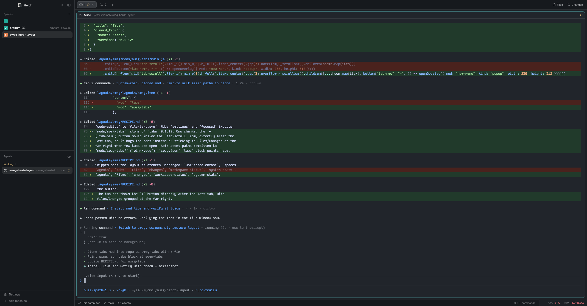

# sweg

Herdr's `main` layout with the side panel moved into the sidebar: Spaces and
Agents on top, Files and Changes opening inside the left column instead of a
right column. Pane headers get a `</>` button that opens the pane's folder in a
code editor (px0 by default) in a split pane beside the terminal.

## What you see

- Left sidebar, 268 px wide (`chrome` background): brand row (46 px), then the
  Spaces and Agents lists sharing the height, then the panel area, then the
  footer row (69 px) with Settings and Add machine.
- The panel sits inside that sidebar between the lists and the footer. Hidden
  by default. When Files or Changes is toggled open it shows a file tree or a
  diff list there, 368 px of the sidebar's height by default, draggable
  between 280 and 900 px.
- Main column on the right: tab bar (42 px) with pill tabs, Files and Changes
  toggle buttons on the right edge. Below it the work area: panes as rounded
  cards (radius 10, 1 px `border`, `accent` on the focused one, 8 px gap) with
  a 30 px header each. Bottom: status bar (28 px), workspace info left,
  `CPU x% MEM y/zG` right.
- Window look comes from the person's `settings.json` (theme, colors, font);
  the layout brings no look of its own. Reference build: `graphite` theme,
  Gruvbox colors, Kode Mono.

## How it behaves

- Files / Changes buttons in the tab bar (and `mod.open:files`,
  `mod.open:changes` keys) reveal the panel inside the sidebar and select the
  stack child. Clicking the active one hides it again. Per-space choice is
  remembered by the `tabs` mod (`localStorage` "panels").
- Pane header hover shows four buttons: `</>` (open editor), split right,
  split down, zoom, close. Click on the header itself focuses the pane.
- `</>` button, `cmd-shift-e`, or the right-click menu item "Open in px0":
  resolves the pane's folder and opens the configured code editor.
- `settings.json` `"code_editor"` picks the tool:
  - `"px0"` (default, also used when the key is missing or names another
    string): runs `pane.split {direction: "right", argv: ["px0", dir,
    "-port", "0"]}` so the px0 server lives in a visible terminal pane beside
    the one that triggered it. px0 opens the browser itself; closing the pane
    stops the server. If a px0 terminal for that folder already exists
    (matched on `terminals()` argv), its pane is focused instead of opening a
    duplicate.
  - `"builtin"`: selects `files` in the `panel-body` stack and shows the
    `panel` node — the sidebar Files panel.
  - `["zed", "$dir"]` (any argv array): `$dir` is replaced with the pane's
    folder and the program is launched detached via `nohup`, no pane.
- Right-click on a pane shows the shipped `menu` items plus
  "Open in <editor label>" after Zoom.
- Agent status in headers is unchanged: spinner while `working`, a
  `blocked`-colored "Needs you" chip, a `done` dot.

## Built from

- `layouts/sweg.json`: clone of `main` 0.1.12. Root `row` has two extra
  properties: `"terminal_menu": "sweg-menu"`, and `pane.header.content.mod`
  points to `sweg-pane`. The `panel` column (id `panel`, child stack
  `panel-body` with `files` + `changes` blocks, `hidden: true`, size 368 px,
  min 280, max 900) moved from `work-body` into `sidebar`, inserted between
  `sidebar-lists` and `sidebar-footer`. All other nodes and ids are `main`'s.
- `mods/sweg-pane`: clone of `pane` 0.1.12. Adds `openEditor()` +
  `editorCwd()` helpers, a `</>` button (own `code.svg`, 16 px stroke 1.3
  lucide `code` icon) rendered first in the hover button group, and a
  `cx.spawn` loop on `nextCommand()` for the `open_editor` key command that
  only acts when `focused().pane` is its own pane. Uses `panes`, `props`,
  `run`, `theme`, `home`, `settings`, `nextCommand`, `exec`, `focused`,
  `spaces`, `terminals`.
- `mods/sweg-menu`: clone of `menu` 0.1.12. Same `openEditor()` helper,
  plus `editorLabel()` for the item name. The `pane` items list gains
  `["Open in <label>", "code-editor", {pane}]` and `choose()` handles that
  command by resolving the target pane's cwd via `panes()`. `menuIcon` maps
  `code-editor` to `file-text.svg`. Adds `settings` and `focused` imports.
- `mods/sweg-tabs`: clone of `tabs` 0.1.12. One change: the `+`
  (`tab-new`) button moved inside the `tab-scroll` row, directly after the
  last tab, so it hugs the tabs instead of sticking to Files/Changes at the
  far right when few tabs are open. Self asset paths rewritten to
  `mods/sweg-tabs/` (`win-*.svg`). `sweg.json` `tabs` block points here.
- `keys.json` snippet: global `"cmd-shift-e": "sweg-pane.open_editor"`.
- Shipped mods the layout references unchanged: `workspace-chrome`, `spaces`,
  `agents`, `files`, `changes`, `workspace-status`, `system-stats`.
  `sweg-menu` reuses `mods/workspace-chrome/*.svg` icons.
- Programs run: `px0 <dir> -port 0` (optional external tool,
  https://px0.ai, `go install` or the px0 installer), and whatever argv the
  person puts in `code_editor`.

## Watch out

- Keep the ids `panel`, `panel-body`, `files`, `changes` exactly: the `tabs`
  mod finds them by id in the layout tree; renaming breaks the toggles.
- The panel lives inside the sidebar's fixed 268 px column (`resizable:
  false`), so the panel is tall and narrow, not wide like before. Its `size`
  {px} is vertical height here, not width.
- `pane.split` argv terminals inherit the source pane's cwd; the px0 dedup
  must match `terminals()` argv, not pane cwd.
- Every `sweg-pane` copy runs the `nextCommand()` loop; only the copy whose
  `props().pane` equals `focused().pane` may act or each pane spawns its own
  split.
- `px0` must be on PATH for the default editor. Without it the new pane shows
  a shell error. `code_editor: "builtin"` needs nothing external.
- Herdr 0.1.12 has no in-app browser pane; px0's UI opens in the system
  browser. Newer Herdr builds with `browser open` could host it inside.
- Installing on a home that already has `sweg-pane`/`sweg-menu` folders or a
  `sweg.json` layout needs renames (folder names and the `mod` values in
  `sweg.json`) per the shared-layout rules.

## Done when

- `herdr-app check` passes on `mods/sweg-pane` and `mods/sweg-menu`.
- `layout.switch {name: "sweg"}` shows the window with no `layout.error`
  file: sidebar lists on top, footer at the bottom of the sidebar, no
  right-hand panel column.
- Clicking Files in the tab bar opens the file tree inside the sidebar;
  clicking again hides it; Changes works the same.
- Hovering a pane header shows the `</>` button before the split buttons.
- `cmd-shift-e` on a focused terminal splits a pane to the right running
  `px0 <that pane's folder> -port 0`; a second press focuses it again.
- `"code_editor": "builtin"` in settings.json makes the same triggers open
  the sidebar Files panel instead.
- Right-click on a pane lists "Open in px0" after Zoom and it behaves like
  the button.
- The tab bar shows the `+` button directly after the last tab, with
  Files/Changes grouped at the far right.
